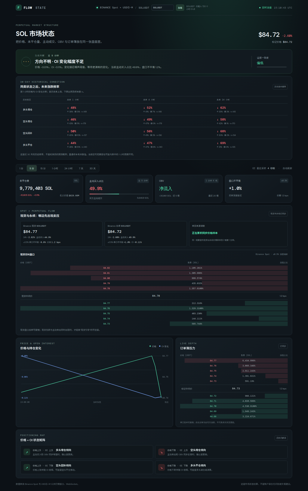

# Flow State

Binance Spot 与 USDⓈ-M 永续市场状态面板。可选择同时在 Binance 现货和 USDT 永续上架的币种，查看对应价格、OI、主动成交、OBV 和订单簿，并给出仓位变化倾向与现货 / 永续卖压对照。

## 运行

不需要 API Key、Python 包或构建步骤。进入项目目录启动静态服务器：

```bash
cd /home/raphael/projects/zec-flow
python3 -m http.server 4173
```

打开 <http://127.0.0.1:4173>。页面需要保持打开以接收实时流。浏览器需要能够访问 Binance Spot 与 USDⓈ-M 的 REST 和 WebSocket 公共市场接口。

## 选择币种

页面顶部输入币种代码（例如 `SOLUSDT`、`ETHUSDT`），从自动补全列表选择后按“加载”或回车。列表由 Binance 当前可交易的现货与 USDⓈ-M USDT 永续合约交集生成；仅支持同时有这两类市场的币种。切换后会重新连接实时行情和订单簿，并自动读取该币种最近 30 天的小时 OI / 价格历史、最近 30 个 5 分钟 OI 点及 1 分钟 K 线。顶部状态显示历史 OI 点数或加载状态。

该站点是纯静态网页，没有后端、账户连接或 API Key。所有市场数据由访问者浏览器直接向 Binance 公共接口请求。网络或币安接口不可用时，对应模块会显示等待 / 获取失败状态；稍后可重新选择币种或刷新页面。

## 页面截图



## 指标和判断逻辑

- **价格与 OI**：每 15 秒轮询当前未平仓量；启动时读取近 30 天 1 小时 OI 历史，并补充最近的 5 分钟数据。Binance 每次最多返回 500 个 OI 历史点，页面按时间游标分页。支持 1 分、5 分、15 分、1 小时、24 小时、7 天和 30 天观察窗。当前 OI 与窗口起点比较时，使用 ZEC 合约数量变化，避免单纯价格波动改变 USD 名义值后被误读成持仓变化。
- **价格上涨 + OI 上涨**：多头增仓倾向。
- **价格下跌 + OI 上涨**：空头增仓倾向。
- **价格上涨 + OI 下跌**：空头回补倾向。
- **价格下跌 + OI 下跌**：多头平仓或清算倾向。
- **主动成交**：读取 aggregate trade 的买方是否为 maker，汇总近 5 分钟主动买卖量。
- **OBV**：根据已收盘 1 分钟 K 线的收盘方向累加成交量，比较近 5 根变化。
- **订单簿**：先获取 REST 深度快照，再按 WebSocket update ID 对齐增量并检查 `pu` 连续性；断档时重新同步。显示 ±0.5% 深度不平衡和前五档。
- **现货与永续对照**：同时订阅 Spot 与 USDⓈ-M 的 aggregate trades 和深度流，比较近 5 分钟价格变化、主动买入占比、两边的盘口深度倾斜，以及价格先越过下跌阈值的时间。现货先跌、现货主动卖出更强时，显示现货先行特征；两者同步变化时不强行归因。
- **证据一致度**：价格/OI 给出初步状态，主动成交、OBV、盘口偏斜最多贡献三项确认。它只是规则一致度，不是经过校准的概率或胜率。
- **历史条件频率**：用近 30 天小时级价格与 OI 样本统计四类状态出现后，未来 1 小时、4 小时和 24 小时下跌的比例，并显示样本数。窗口重叠会产生相关样本，因此这不是校准预测概率。

## 重要边界

每张合约都同时有多头和空头。公开 OI 只表示未平仓合约数量，不能识别究竟是哪一类账户开仓或平仓；价格、主动成交方向和 OI 的组合只是市场主导行为的估算。强平与主动平仓也不能只靠 OI 区分。盘口挂单可能撤销，因此不等于真实成交意愿。Binance OI 历史接口只保留最近一个月，并且没有交易的周期会省略。Binance Vision 也发布日频 `bookDepth` 历史档案，但它是按离中间价百分比汇总的累计深度快照，不能还原完整逐价 L2 订单簿；已发布的近中间价卖盘档位也有过冻结问题。当前面板的逐价盘口来自实时深度流；浏览器打开期间，程序才会累积实时盘口和成交样本。

数据接口均为 Binance Spot / USDⓈ-M Futures 公共市场接口，不含用户账户、API Key 或下单功能。公开现货 K 线、aggregate trades 和合约 K 线有历史查询 / 归档；OI 统计接口只保留最近一个月。`bookDepth` 日归档提供按百分比带汇总的累计深度，无法还原完整逐价 L2 订单簿；归档还出现过近中间价卖盘档位冻结的情况。面板的现货和永续逐价盘口来自实时深度流。

## 参考资料

- [Binance USDⓈ-M Futures REST API：Market Data](https://developers.binance.com/docs/derivatives/usds-margined-futures/market-data/rest-api)
- [Binance USDⓈ-M Futures：WebSocket Market Streams](https://developers.binance.com/docs/derivatives/usds-margined-futures/websocket-market-streams)
- [Binance：如何正确维护本地订单簿](https://developers.binance.com/docs/derivatives/usds-margined-futures/websocket-market-streams/How-to-manage-a-local-order-book-correctly)
- [Open Interest Statistics](https://developers.binance.com/docs/derivatives/usds-margined-futures/market-data/rest-api/Open-Interest-Statistics)
- [Aggregate Trade Streams](https://developers.binance.com/docs/derivatives/usds-margined-futures/websocket-market-streams/Aggregate-Trade-Streams)
- [Binance Spot REST Market Data](https://developers.binance.com/docs/binance-spot-api-docs/rest-api/market-data-endpoints)
- [Binance Spot WebSocket Market Streams](https://developers.binance.com/docs/binance-spot-api-docs/web-socket-streams)
- [Binance Public Data: Futures archives](https://github.com/binance/binance-public-data)
